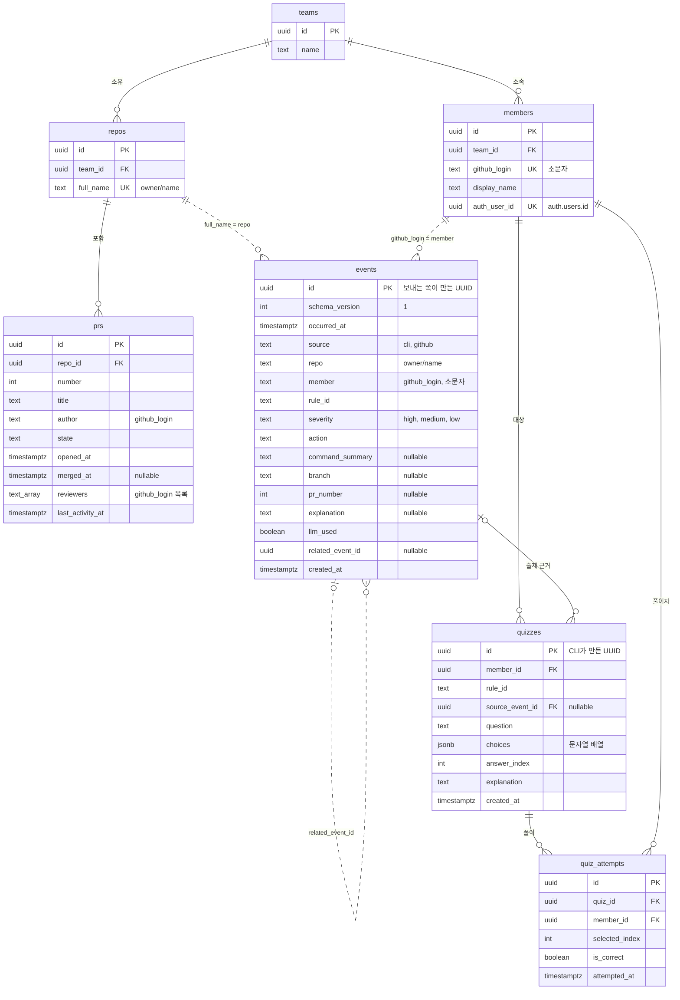

# ERD — Supabase DB

> 버전: **v1** (2026-11-08 확정) · 담당: 이남주(DB)
> 기준: 이벤트 JSON 계약은 [`docs/guide/01_cli.md` 6절](../guide/01_cli.md)(이벤트 스키마 v1)을 따른다. 이 문서는 테이블·DB 제약·점검 쿼리·인덱스·RLS·뷰의 기준이다.
>
> 테이블은 `supabase/migrations/`의 마이그레이션으로만 만든다(11/14~). 이 문서와 마이그레이션이 다르면 마이그레이션이 실제 상태다.
> 스키마(특히 이벤트 JSON) 필드를 추가·변경하려면 PR + CLI·웹·DB 담당 3명 승인이 필요하다.

## 다이어그램

점선 관계는 **FK 없이 문자열로 매칭**한다.

- `events.repo` = `repos.full_name`
- `events.member` = `members.github_login`
- `events.related_event_id` = `events.id`. sync 순서가 뒤바뀌어도 적재되도록 FK를 걸지 않는다.

## 관계

| 부모 | 자식 | 카디널리티 | 연결 | 비고 |
|---|---|---|---|---|
| teams | repos | 1 : 0..N | `repos.team_id` | |
| teams | members | 1 : 0..N | `members.team_id` | |
| repos | prs | 1 : 0..N | `prs.repo_id` | `(repo_id, number)` UK |
| repos | events | 1 : 0..N | `full_name = repo` | FK 없음 |
| members | events | 1 : 0..N | `github_login = member` | FK 없음 |
| events | events | 0..1 : 0..N | `related_event_id` | FK 없음. 아래 "related_event_id" 참고 |
| members | quizzes | 1 : 0..N | `quizzes.member_id` | |
| events | quizzes | 0..1 : 0..N | `quizzes.source_event_id` | 이벤트가 먼저 적재되어 있어야 함 |
| quizzes | quiz_attempts | 1 : 0..N | `quiz_attempts.quiz_id` | |
| members | quiz_attempts | 1 : 0..N | `quiz_attempts.member_id` | |

## 테이블

### teams
| 컬럼 | 타입 | 키 | 비고 |
|---|---|---|---|
| id | uuid | PK | |
| name | text | | |

### members
| 컬럼 | 타입 | 키 | 비고 |
|---|---|---|---|
| id | uuid | PK | |
| team_id | uuid | FK → teams | |
| github_login | text | UK | **소문자만** |
| display_name | text | | |
| auth_user_id | uuid | UK | `auth.users.id`. GitHub 로그인 후 연결, RLS 판정에 사용 |

### repos
| 컬럼 | 타입 | 키 | 비고 |
|---|---|---|---|
| id | uuid | PK | |
| team_id | uuid | FK → teams | |
| full_name | text | UK | `owner/name` |

### prs (watcher가 채움)
| 컬럼 | 타입 | 키 | 비고 |
|---|---|---|---|
| id | uuid | PK | |
| repo_id | uuid | FK → repos | |
| number | int | | `(repo_id, number)` UK |
| title | text | | PR 제목 (방치 PR 목록 표시용) |
| author | text | | github_login |
| state | text | | 값 목록은 watcher와 확정 예정 |
| opened_at | timestamptz | | |
| merged_at | timestamptz | | nullable |
| reviewers | text[] | | github_login 목록 |
| last_activity_at | timestamptz | | 방치 PR 판정 기준 |

### events (CLI·watcher 공통 계약, 모든 통계의 원천)
| 컬럼 | 타입 | 필수 | 비고 |
|---|---|---|---|
| id | uuid | ✔ | **보내는 쪽이 만든 UUID.** DB는 생성하지 않는다 |
| schema_version | int | ✔ | `1` |
| occurred_at | timestamptz | ✔ | 타임존 오프셋 필수 (예: `+09:00`) |
| source | text | ✔ | `cli` · `github` |
| repo | text | ✔ | `owner/name` |
| member | text | ✔ | github_login, **소문자만** |
| rule_id | text | ✔ | `R01` ~ (규칙 추가 가능성이 있어 값 제약 없음) |
| severity | text | ✔ | `high` · `medium` · `low` |
| action | text | ✔ | 아래 표 |
| command_summary | text | | 시크릿 값 금지 |
| branch | text | | |
| pr_number | int | | |
| explanation | text | | `allowed`면 null |
| llm_used | boolean | | 기본 false. `allowed`면 false |
| related_event_id | uuid | | 아래 표 |
| created_at | timestamptz | | DB 적재 시각 (default now()) |

### quizzes (CLI·watcher가 Ollama로 생성, 웹은 표시만)
| 컬럼 | 타입 | 키 | 비고 |
|---|---|---|---|
| id | uuid | PK | CLI가 만든 UUID (재전송 중복 방지) |
| member_id | uuid | FK → members | CLI는 `member`(github_login)를 보내고 DB 함수가 변환 |
| rule_id | text | | |
| source_event_id | uuid | FK → events | nullable |
| question | text | | |
| choices | jsonb | | 문자열 배열, 2개 이상 |
| answer_index | int | | 0부터. `choices` 범위 안 |
| explanation | text | | |
| created_at | timestamptz | | default now() |

### quiz_attempts
| 컬럼 | 타입 | 키 | 비고 |
|---|---|---|---|
| id | uuid | PK | |
| quiz_id | uuid | FK → quizzes | |
| member_id | uuid | FK → members | |
| selected_index | int | | 0 이상 |
| is_correct | boolean | | |
| attempted_at | timestamptz | | default now() |

> 퀴즈 저장 경로(Edge Function 구성 등)는 11/24 퀴즈 작업 때 다시 맞춘다.

## events 규칙

### action

| action | source | 의미 | related_event_id | explanation / llm_used |
|---|---|---|---|---|
| `allowed` | cli | 위반을 보고도 "그냥 실행"을 골라 실행됨 | null | **항상 null / false** |
| `guided` | cli | "어떻게 해야 하나요?"를 골라 원래 명령이 취소되고 가이드 시작 | null | 설명 있음 (LLM 또는 템플릿) |
| `guided` (복구) | cli | `gitcoach guide undo`로 시작한 복구 가이드 | 원래 `allowed` 이벤트 | 설명 있음 |
| `blocked` | cli | **R03(비밀 정보) 전용** 차단 | null | |
| `guide_completed` | cli | 가이드를 끝까지 진행 | 원래 `guided` (**필수**) | |
| `guide_stopped` | cli | `guide stop`으로 중단 (`guide skip` 포함) | 원래 `guided` (**필수**) | |
| `detected` | github | watcher가 GitHub에서 감지한 위반 | null | |

- 위반이 **없는** 명령은 기록하지 않는다. `events`에는 위반 기록만 있다.
- 한 명령에 위반이 여러 개면 위반마다 이벤트가 하나씩(id 따로) 생긴다.
- 단, R03이 다른 위반과 함께 걸려 [q]로 취소하면 R03 `blocked` 하나만 남기고 함께 걸린 위반은 기록하지 않는다(명령이 실행되지 않았으므로).
- 가이드 결과(`guide_completed`·`guide_stopped`)의 `rule_id`·`severity`·`repo`·`member`·`branch`는 원래 `guided`와 같다.
- 다른 규칙에서 Ctrl+C로 중간에 끈 명령은 이벤트가 남지 않는다.

### DB 제약 (어기면 적재 거절)

| 제약 | 내용 |
|---|---|
| 값 목록 | `source`, `severity`, `action`, `schema_version = 1` |
| source ↔ action | `detected`는 `github`만, 나머지 action은 `cli`만 |
| related_event_id | 가이드 결과면 not null, `guided`면 선택, 나머지는 null |
| allowed | `explanation is null and llm_used = false` |
| 소문자 | `member = lower(member)`, `github_login = lower(github_login)` |

### 점검 쿼리로 보는 것 (제약 아님, 이상 데이터 탐지)

규칙별·행 사이 로직은 규칙이 바뀔 때마다 마이그레이션이 필요해지므로 제약으로 걸지 않는다.

- R03인데 `allowed` (R03에는 "그냥 실행"이 없음)
- `blocked`인데 R03이 아님
- `related_event_id`가 가리키는 이벤트가 없음(sync 지연·유실), 또는 대상 action이 틀림 (가이드 결과 → `guided`, 복구 가이드 → `allowed`)
- 가이드 결과의 값이 원래 `guided`와 다름

### 적재

- 항상 `insert ... on conflict (id) do nothing`. **같은 이벤트를 다시 보내도 한 번만 저장된다.**
- CLI는 Edge Function `ingest-events`로 보낸다(학생 PC에 서버 키 없음). watcher는 서버 키로 직접 쓴다.
- 같은 sync에서는 events를 먼저, quizzes를 나중에 넣는다.

## 인덱스

| 테이블 | 인덱스 | 용도 |
|---|---|---|
| events | `(repo, occurred_at desc)` | 레포별 타임라인 |
| events | `(member, occurred_at desc)` | 멤버별 기록 |
| events | `(rule_id, action)` | 규칙 통계 |
| events | `(related_event_id)` where not null | 가이드 짝 맞추기 |
| quizzes | `(member_id, created_at desc)` | 내 퀴즈 |
| quiz_attempts | `(member_id, attempted_at desc)` | 내 풀이 기록 |

## 보안 (RLS)

- **모든 테이블에 RLS를 켠다.** 정책 없이는 anon/authenticated가 아무것도 읽지 못한다.
- 판정 기준: `auth.uid()` → `members.auth_user_id` → `team_id` / `member_id`
  - 같은 팀 데이터만 읽는다.
  - `quiz_attempts`와 "내 기록"은 본인 것만 읽는다.
- 웹은 테이블이 아니라 `security_invoker = true` 뷰를 읽는다. 정책·뷰는 별도 마이그레이션(11/19~20)에서 만든다.

## 조회 뷰 (예정)

| 뷰 | 내용 |
|---|---|
| `v_rule_stats` | 규칙별 집계 (rule_id·action·severity별 건수) |
| `v_member_activity` | 멤버별 PR·리뷰 활동 |
| `v_stale_prs` | 방치된 PR (`last_activity_at` 기준) |
| `v_guide_completion` | 규칙·멤버별 `guided` 대비 `guide_completed`·`guide_stopped` 비율 |

반환 컬럼은 웹 `lib/data/` 타입(11/16 전후)에 맞춰 정한다.

- `quizzes`·`quiz_attempts`의 `member_id`는 뷰에서 `members`와 조인해 `github_login`을 `member` 컬럼으로 내보낸다.
- `v_stale_prs`의 `url`은 저장하지 않고 뷰에서 `'https://github.com/' || repos.full_name || '/pull/' || prs.number`로 만든다.

## 변경 이력

| 버전 | 날짜 | 내용 |
|---|---|---|
| v1 | 2026-11-08 | action을 v1 값 6개로 교체(v0 `blocked/ran/warned` 폐기), `related_event_id` 추가, `severity` 값 확정, `members.auth_user_id` 채택, `quizzes.created_at` 추가, 소문자·allowed 제약 확정, 퀴즈 id를 CLI 생성으로 변경, `prs.title` 추가, `quiz_attempts.correct` → `is_correct` (PR #12 리뷰) |
