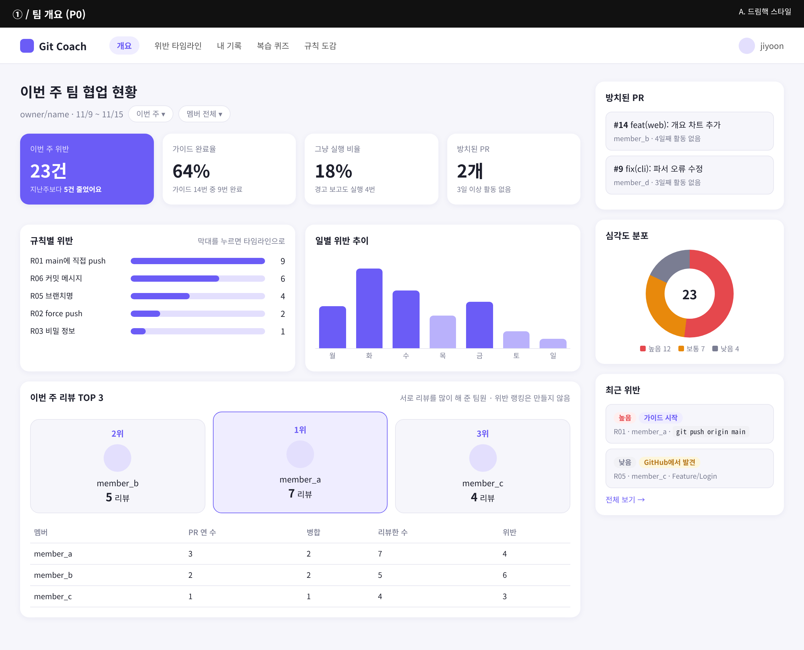
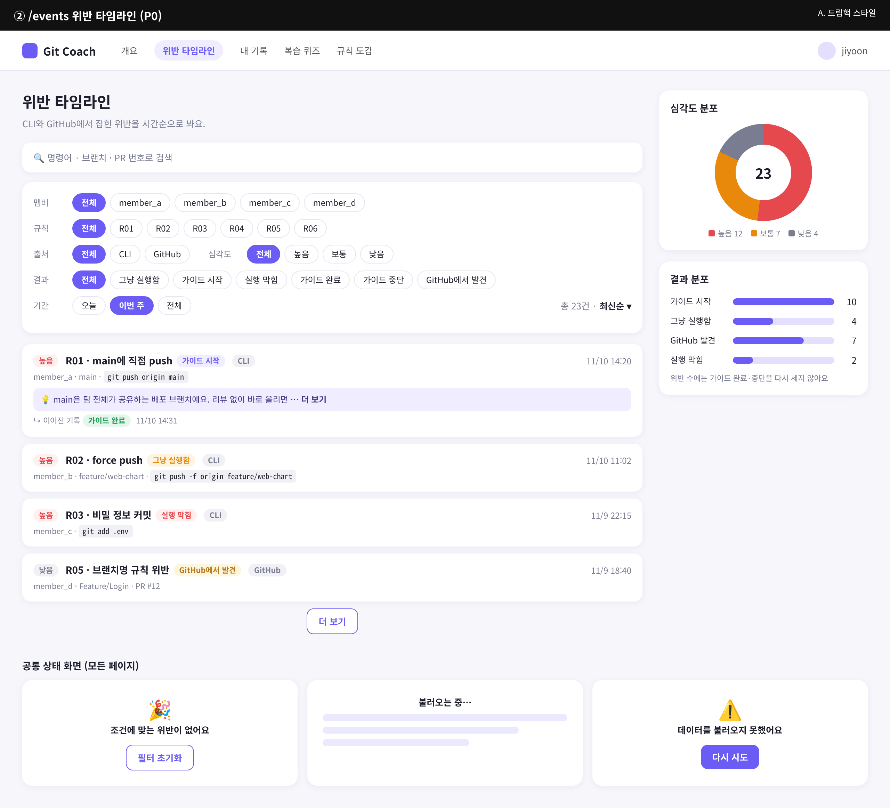
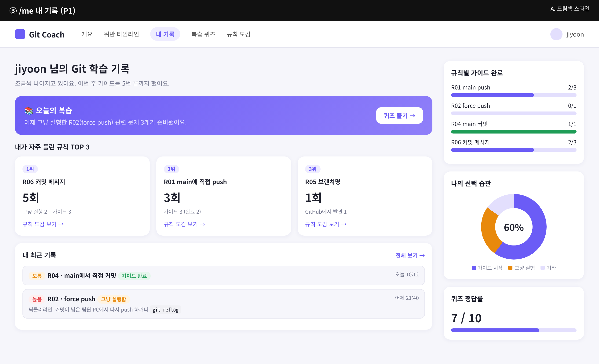
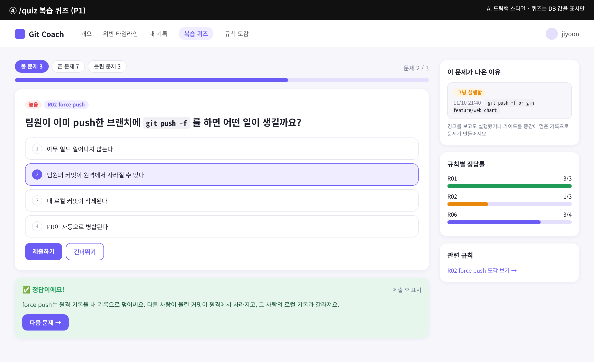
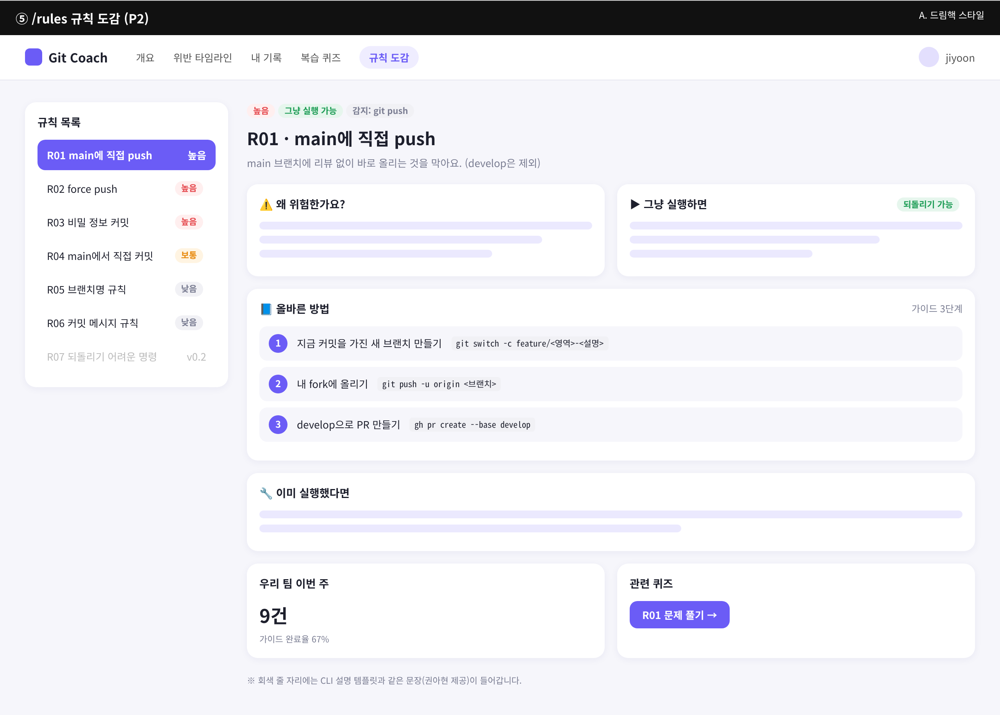

# 웹 대시보드 와이어프레임 (v0.1)

페이지 5개의 화면 구성 초안입니다. 레이아웃과 분위기는 [Dreamhack](https://dreamhack.io)("해커들의 놀이터")을 참고했고, 데이터는 이벤트 스키마 v1(`dashboard/types/event.ts`)과 `lib/data/` 인터페이스 기준입니다. 숫자와 멤버 이름은 모두 예시입니다.

스타일은 시안 3개(드림핵 / 해커 터미널 / GitHub) 중 **A. 드림핵 스타일**로 정했습니다.

## 디자인 규칙 (A. 드림핵 스타일)

11/9 Next.js 골격을 만들 때 아래 값을 Tailwind 설정(`theme.extend.colors` 등)에 그대로 옮깁니다.

### 색

| 이름 | 값 | 쓰는 곳 |
|---|---|---|
| `bg` | `#f6f6fb` | 페이지 배경 |
| `surface` | `#ffffff` | 카드 배경 |
| `border` | `#e6e6f0` | 구분선, 칩 테두리 |
| `text` | `#1d1f2c` | 본문 글자 |
| `muted` | `#7a7d92` | 보조 글자, 축 레이블 |
| `accent` | `#6b5cf6` | 강조, 선택된 메뉴·칩, 버튼, 차트 막대 |
| `accent-soft` | `#efedff` | 강조 배경 (선택된 메뉴, 설명 박스) |
| `accent-light` | `#b9b1fb` / `#e3dffd` | 차트 보조 막대 / 막대 바탕 |

### 상태 색 (배지)

| 의미 | 글자 | 배경 | 쓰는 값 |
|---|---|---|---|
| 높음 · 실행 막힘 | `#e5484d` | `#ffefef` | severity `high`, action `blocked` |
| 보통 · 그냥 실행함 | `#e8890c` | `#fff4e2` | severity `medium`, action `allowed` |
| 낮음 · 가이드 중단 | `#7a7d92` | `#f1f1f5` | severity `low`, action `guide_stopped` |
| 가이드 시작 | `#6b5cf6` | `#efedff` | action `guided` |
| 가이드 완료 | `#1f9d57` | `#e6f6ed` | action `guide_completed` |
| GitHub에서 발견 | `#b7791f` | `#fdf6dc` | action `detected` |

`lib/labels.ts`의 `tone`(danger · warning · neutral · info · success)과 위 색을 연결합니다.

### 모양과 글꼴

- 카드: 모서리 14px, 테두리 없이 옅은 그림자(`0 2px 10px rgba(40,30,120,.06)`)
- 배지·칩: 완전히 둥글게(999px). 선택된 칩은 `accent` 배경 + 흰 글자
- 핵심 숫자 카드(개요의 "이번 주 위반")만 `accent` 배경으로 강조
- 글꼴: 본문 Pretendard 또는 Noto Sans KR, 명령어는 고정폭 글꼴(`git push origin main`)
- 위반 랭킹은 만들지 않습니다. 랭킹은 리뷰 TOP3처럼 칭찬에만 씁니다.

## Dreamhack에서 가져온 구성

| Dreamhack 화면 | 우리 페이지 | 가져온 점 |
|---|---|---|
| 상단 메뉴 | 전체 | 로고 + 메뉴 5개 + 오른쪽 사용자 |
| 워게임 대시보드 (오른쪽 사이드바) | `/`, `/me` | 본문 + 오른쪽 요약 카드(진행 막대, 분포 도넛) |
| 랭킹 (TOP3 시상대 + 표) | `/` | 리뷰 TOP3 시상대. **칭찬용으로만** 쓰고 위반 랭킹은 만들지 않음 |
| 워게임 문제 탐색 (검색 + 필터 칩) | `/events` | 검색창, 행별 필터 칩, 정렬, 오른쪽 분포 도넛 |
| My Class (분야별 진행 막대) | `/me` | 규칙별 가이드 완료 n/m 막대 |
| 키워드별 학습 / Unit | `/rules` | 왼쪽 목록 + 오른쪽 상세 |

## 페이지

### ① `/` 팀 개요 (P0)

- KPI: 이번 주 위반, 가이드 완료율, 그냥 실행 비율, 방치된 PR
- 규칙별 위반 비율(막대 클릭 → `/events?rule=…`), 일별 추이, 리뷰 TOP3 + 멤버별 PR·리뷰 표
- 사이드바: 방치된 PR, 심각도 분포, 최근 위반
- 데이터: `getRuleStats`, `getGuideStats`, `getMemberActivity`, `getStalePrs`, `getEvents`

### ② `/events` 위반 타임라인 (P0)

- 필터: 멤버 · 규칙 · 출처 · 심각도 · 결과(action 6개) · 기간. **필터 상태는 URL 쿼리에 저장**해 개요 차트와 공유
- 이벤트 카드: 심각도, 규칙, 결과 배지, 명령 요약, 멤버, 브랜치, 시간, LLM 설명(펼치기), `related_event_id`로 연결된 가이드 완료·중단 기록
- 공통 상태 화면(빈 상태·로딩·오류)은 모든 페이지에 적용
- 데이터: `getEvents(filter)`

### ③ `/me` 내 기록 (P1)

- 오늘의 복습 → `/quiz`, 자주 틀린 규칙 TOP3, 내 최근 기록
- 사이드바: 규칙별 가이드 완료 진행 막대, 선택 습관, 퀴즈 정답률
- v0.1은 현재 사용자를 설정값으로 고정, DB 단계에서 GitHub 로그인으로 교체
- 데이터: `getRuleStats({members:[me]})`, `getGuideStats`, `getEvents`, `getQuizAttempts`

### ④ `/quiz` 복습 퀴즈 (P1)

- 4지선다, 제출 후 정답·해설
- 사이드바: 출제 근거 이벤트(`allowed`·`guide_stopped`), 규칙별 정답률
- **퀴즈는 웹에서 만들지 않음.** DB에 저장된 퀴즈를 표시만 함 (v0.1은 고정 문제로 UI만)
- 데이터: `getQuizzes`, `getQuizAttempts`

### ⑤ `/rules` 규칙 도감 (P2)

- 왼쪽 R01~R07 목록, 오른쪽 상세: 왜 위험한지, 그냥 실행하면, 가이드 단계, 사후 복구
- 설명 문장은 CLI 템플릿과 같은 텍스트를 받아 정적 데이터로 사용 (회색 줄은 자리표시)

## 피드백 받고 싶은 점
1. 메뉴 이름(개요 / 위반 타임라인 / 내 기록 / 복습 퀴즈 / 규칙 도감)
2. 개요의 리뷰 TOP3를 넣을지 (위반 랭킹은 의도적으로 뺐음)
3. `/events` 필터가 많은데, 기본으로 접어 둘 행이 있는지
